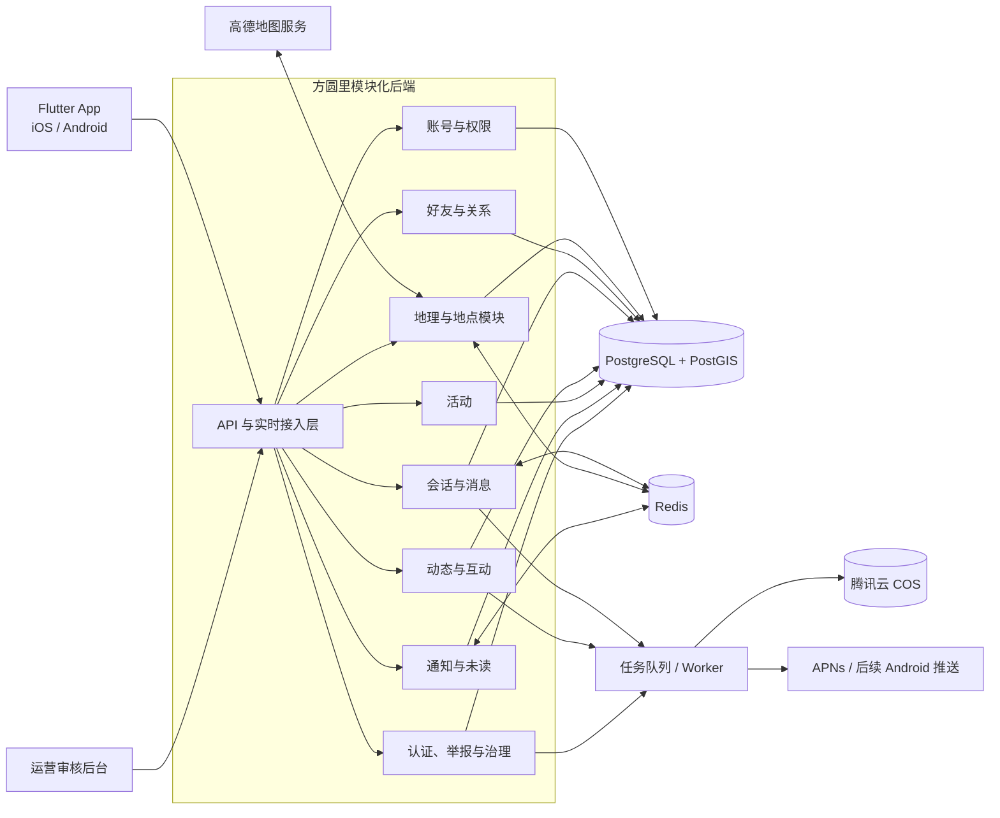
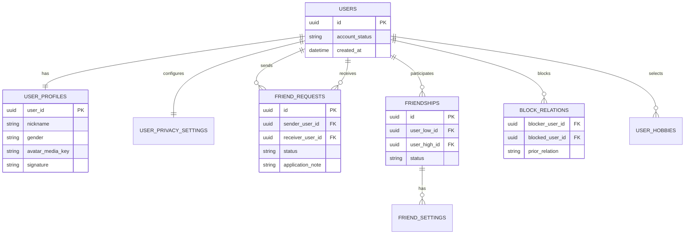
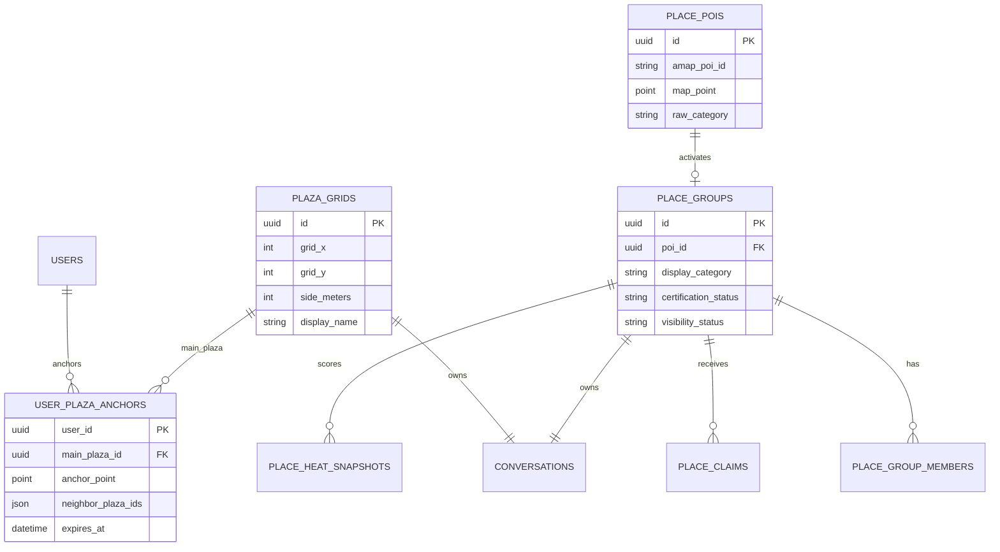
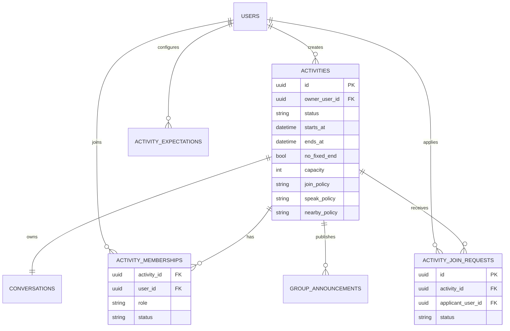
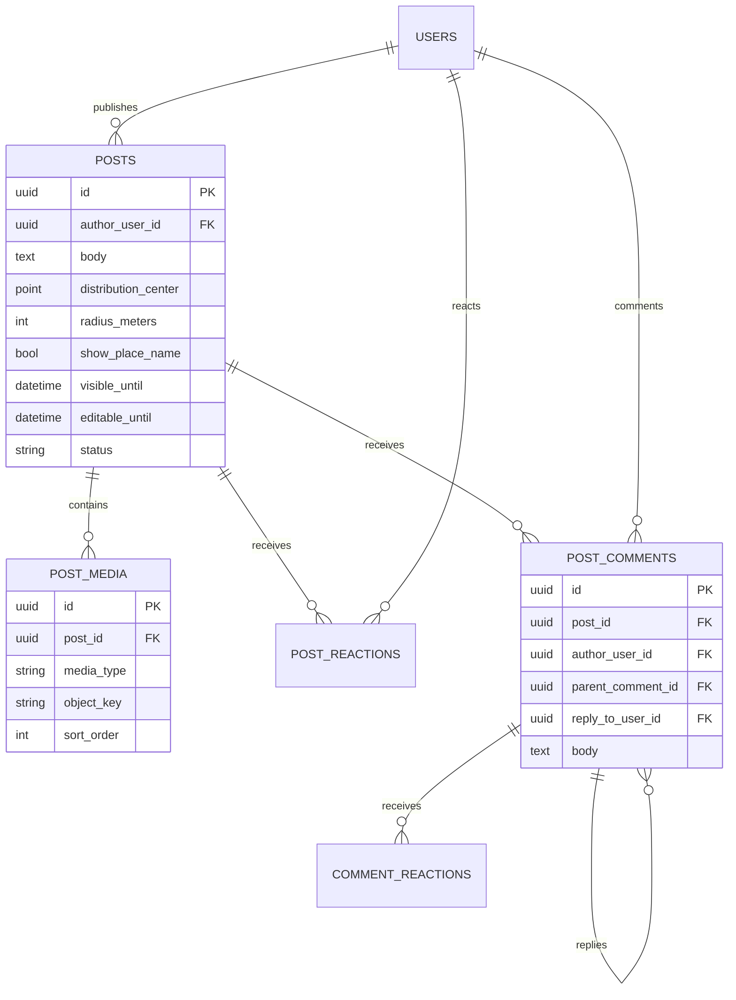
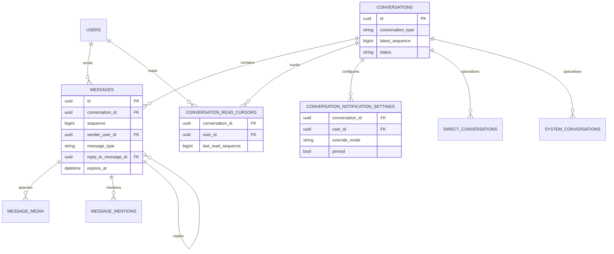
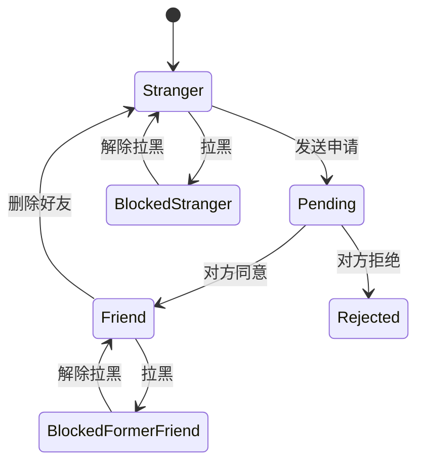
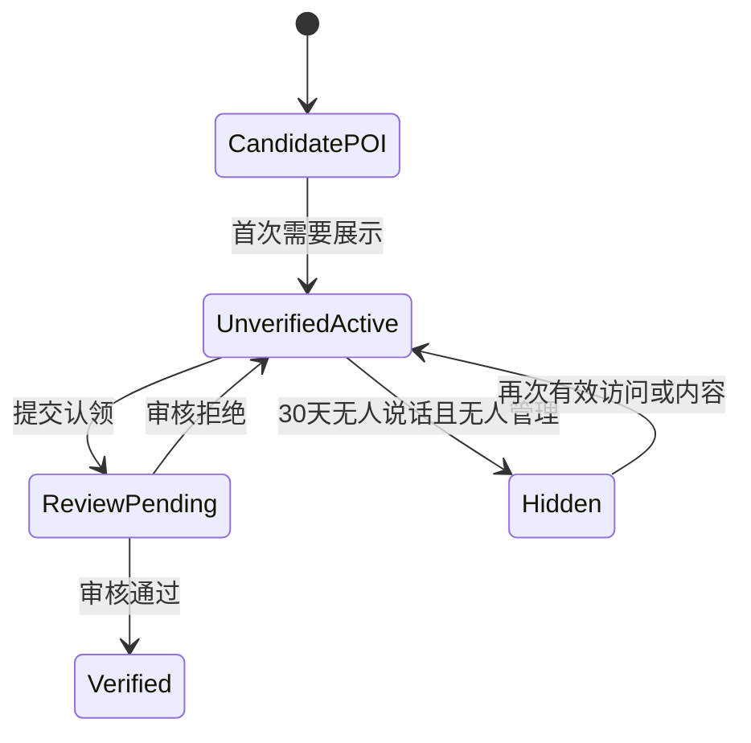
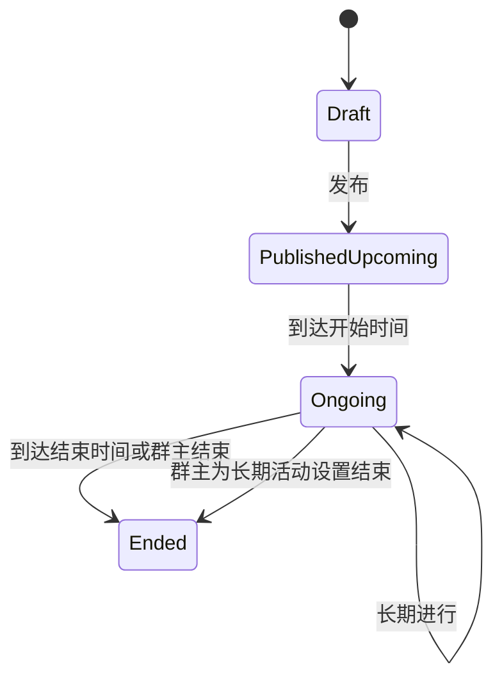

# 方圆里 MVP v1.0 数据模型与系统架构 v0.1

> 文档状态：技术设计初稿
> 对应产品规格：`方圆里 MVP v1.0 产品规格书`
> 目标：把已经确认的产品规则转换成可开发、可扩展、可验证的数据与系统设计。

---

## 0. 这份文档解决什么问题

原型已经验证了主要页面和交互，但正式 App 不能继续把状态写死在页面里。第二阶段需要先建立统一的数据底座，确保：

1. 同一个头像从动态、评论、活动通知、地点聊天进入时，打开的是同一位用户、同一套资料权限。
2. 同意好友申请后，联系人、私聊、资料页和对方账号同时得到一致结果。
3. 拉黑、解除拉黑、删除好友不会在不同页面出现相互矛盾的状态。
4. 广场、地点、活动和私聊共用消息、已读、未读、免打扰和媒体过期逻辑。
5. 用户发布的同一条动态，在广场、好友动态、个人资料和通知跳转中引用同一份数据。
6. 地理计算和公开展示分离，不向其他用户泄露精准位置。
7. 后续修改产品规则时，优先改配置、枚举或单一模块，而不是逐页修补。

---

## 1. 技术决策摘要

### 1.1 已确认的产品约束

- 客户端正式版采用 Flutter，优先支持 iPhone，同时保留 Android 能力。
- 中国大陆地图、定位、POI、逆地理编码和导航使用高德地图。
- 广场采用固定正方形网格；一次显示主广场和三个相邻广场，四个均可发言。
- 广场组合使用暂定 150 米锚点及连续定位、停留时间等条件稳定切换。
- 地点群按高德 POI 懒创建，商家、小区及其他地点各自独立。
- 陌生人必须先成为好友，才可以建立私聊。
- 广场、地点、活动、私聊使用统一聊天能力。
- 未读状态由服务端保存，正常未读显示红色，免打扰未读显示灰色。
- 动态在不同入口复用同一条内容、媒体和互动数据。
- 所有管理、认证、权限、删除和高风险行为必须可审计。

### 1.2 本技术方案建议

| 项目 | MVP 选择 | 原因 |
|---|---|---|
| 后端形态 | TypeScript + NestJS 11 模块化单体 | 开发和部署简单，模块边界清晰，未来可拆分 |
| 关系数据库 | PostgreSQL + PostGIS | 同时处理关系数据、事务和地理查询 |
| 缓存与实时状态 | Redis | 在线状态、短期定位状态、未读缓存、分布式锁 |
| 媒体存储 | 腾讯云 COS | 图片、语音、视频不进入关系数据库 |
| 实时聊天 | WebSocket 网关 | 支持消息推送、已读同步和多设备状态 |
| 异步任务 | 任务队列 + Worker | 转码、缩略图、通知、热度计算、过期清理 |
| 搜索 | PostgreSQL 索引起步 | MVP 不急于部署 Elasticsearch，降低成本 |
| 部署 | 腾讯云单地域、多可用区可扩展 | 第一版先简化，保留横向扩容能力 |

后端技术已经在《技术选型与工程实施方案 v0.1》中确定为 Node.js 24 LTS、TypeScript、NestJS 11 + Fastify。数据访问采用 Kysely + `pg`，数据库迁移以 SQL 为最终事实。

### 1.3 为什么不立即使用微服务

方圆里当前更需要快速验证产品，而不是承担微服务的部署、链路追踪、分布式事务和运维成本。第一版使用一个后端仓库和一个主要 API 服务，但内部按模块隔离：

- 模块之间通过应用服务和明确接口调用；
- 不允许页面或其他模块绕过业务层直接修改核心表；
- 实时消息、媒体处理和后台任务可以作为独立进程运行；
- 用户量增长后，可优先拆分聊天、媒体、搜索和推荐。

---

## 2. 总体系统结构



### 2.1 运行进程

MVP 建议至少包含以下运行单元：

1. **API 服务**：登录、资料、好友、地点、活动、动态、设置和管理接口。
2. **WebSocket 服务**：实时消息、已读回执、会话更新和在线事件。
3. **异步 Worker**：图片处理、视频转码、推送、热度更新、过期清理。
4. **运营后台**：认证审核、地点纠错、举报处理、参数配置和审计查询。

它们可以使用同一个代码仓库和业务模块，不等于四套独立微服务。

---

## 3. 业务模块边界

| 模块 | 负责 | 不负责 |
|---|---|---|
| 账号与资料 | 登录、账号、资料、隐私、设备、性别 | 好友关系、群内角色 |
| 地理与广场 | 定位状态、网格、锚点、四广场、命名 | 公开用户坐标 |
| 地点 | POI、懒创建、分类、认证状态、热度 | 活动和临时群 |
| 活动 | 创建、报名、审批、人数、时间、活动角色 | 好友关系本身 |
| 好友与关系 | 申请、好友、备注、权限、拉黑 | 聊天消息内容 |
| 会话与消息 | 消息顺序、内容、引用、媒体、已读 | 地点认证、活动报名 |
| 动态与互动 | 动态、媒体、点赞、评论、回复、可见规则 | 私聊消息 |
| 通知 | 系统会话、红灰未读、推送策略 | 业务事实的最终状态 |
| 治理与审计 | 举报、证据、认证审核、操作日志 | 页面临时 UI 状态 |

### 3.1 单一事实来源

同一业务事实只能有一个权威来源：

| 事实 | 权威数据 |
|---|---|
| 是否好友 | `friendships` |
| 当前备注 | `friend_settings.remark_name` |
| 是否拉黑 | `block_relations` |
| 动态正文和媒体 | `posts`、`post_media` |
| 点赞和评论数 | 互动表汇总或事务内计数 |
| 活动当前成员数 | `activity_memberships` |
| 群内身份 | 对应群成员角色，不由前端按钮推断 |
| 是否已读 | `conversation_read_cursors` |
| 红点或灰点 | 未读数量 + 有效通知策略计算 |
| 地点是否认证 | 当前有效的 `place_claims` 审核结果 |

前端可以缓存这些结果，但不能自己创造另一套永久状态。

---

## 4. 核心数据模型

完整字段级设计见：

- `database/fangyuanli-mvp-v1.dbml`

### 4.1 用户、好友和黑名单



关键设计：

- 好友关系使用一条无方向记录，用户 ID 按稳定顺序保存，防止同一对用户产生两条关系。
- 备注和“仅聊天”等设置是有方向的：甲给乙的备注，不会修改乙的昵称。
- 拉黑是有方向的，但会记录拉黑前关系。解除时恢复为原好友或陌生人。
- 任意一方对另一方存在有效拉黑时，双方私聊都停止发送；解除后再根据拉黑前关系恢复。
- 好友申请同意、好友关系建立、联系人可见和私聊会话创建必须处于同一事务或同一可靠事件流程中。
- 同意好友申请后不自动发送问候消息。

### 4.2 广场、地点与位置隐私



关键设计：

- 高德原始 POI 与方圆里地点群分开。POI 可以存在但地点群尚未激活。
- 地点群懒创建后绑定稳定 `place_group_id`，同一 POI 不重复创建。
- 商家、小区、场馆等通过类别字段区分，不建立相互包含关系。
- 用户的最新地址和锚点主要放 Redis；数据库只保存必要的当前状态和有限审计，不永久保存完整轨迹。
- 小区“7 天活跃 4 天”只保存按天资格证据，不保存用户每天的详细移动路线。
- 客户端永远拿不到其他用户的原始坐标。

### 4.3 活动、报名与群管理



关键设计：

- 创建页和管理页必须读写同一组字段和枚举，不能分别维护两套设置。
- 当前人数来自有效成员记录。修改人数上限时在数据库事务中再次校验，不能只依赖前端提示。
- 群主、管理员、已报名成员、附近的人是四种明确身份；权限由服务端计算。
- “长期进行”使用 `no_fixed_end=true` 且 `ends_at=null`，不是填一个遥远的虚假日期。
- 附近用户不是永久成员；可见和发言根据当前位置、活动状态和规则实时判定。

### 4.4 动态、评论与个人资料复用



关键设计：

- 广场动态、好友动态、自己资料、他人资料和动态通知都只保存 `post_id`，展示时读取同一动态。
- 评论回复同时记录 `parent_comment_id` 和 `reply_to_user_id`，因此点击 @用户名可进入正确资料。
- 动态详情和列表使用同一数据结构、同一互动接口，仅布局不同。
- 1 分钟可编辑由服务端 `editable_until` 校验；客户端隐藏按钮只是体验优化。
- 动态可见期限控制分发，不自动删除原内容。好友资料可见还要叠加隐私和好友权限。

### 4.5 统一会话、消息与未读



#### 未读计算

每个会话内的消息按单调递增 `sequence` 排序：

```text
未读数 = 会话当前最新序号 - 用户最后已读序号
```

实际计算会排除已撤回、用户无权查看和不计未读的系统事件。Redis 保存快速计数，PostgreSQL 的已读游标是最终事实。

#### 红点与灰点

```text
有效通知模式 =
    会话单独设置（若存在）
    否则群类会话使用全局免打扰
    否则使用正常通知

未读数 > 0 且有效模式为正常  => 红点，计入底部导航
未读数 > 0 且有效模式为免打扰 => 灰点，不计入底部导航
未读数 = 0                    => 不显示
```

#### “N 条新消息”

- 打开聊天默认定位底部最新消息。
- 首次进入时记录第一条未读消息序号。
- 只要本次未读尚未完成阅读，屏幕内显示“N 条新消息”。
- 点击后定位第一条未读，并保留当前会话上下文。
- 完成阅读并提交新游标后，红/灰未读和“N 条新消息”共同消失。
- 多设备通过服务端游标同步，不能仅存在手机内存。

#### 消息幂等与顺序

- 客户端每次发送生成 `client_message_id`。
- 服务端以“发送者 + client_message_id”去重，网络重试不会重复发两条。
- 服务端在会话事务中分配 `sequence`，所有设备按该序号排序。
- 客户端先显示“发送中”，收到确认后替换为正式消息 ID 和序号。
- 被对方拉黑时，服务端拒绝发送并返回明确失败状态。

---

## 5. 统一群模型与权限

广场、地点和活动都拥有会话，但并不强行共享完全相同的成员模型。

| 对象 | 是否有永久成员表 | 角色来源 | 发言判定 |
|---|---|---|---|
| 广场 | 否 | 当前有效位置 | 四广场资格 + 平台限制 |
| 地点商家群 | 仅保存群主/管理员等管理成员 | 认证和任命 | 位置/管理身份 + 群规则 |
| 地点小区群 | 保存居民资格和管理员 | 本地活跃、投票 | 范围/居民身份 + 群规则 |
| 活动群 | 是 | 报名、审批、任命 | 活动状态 + 成员角色 + 群规则 |
| 私聊 | 两位参与者 | 好友关系 | 好友有效且未被对方拉黑 |

### 5.1 权限判定顺序

所有写操作由服务端按相同顺序判断：

1. 账号是否可用；
2. 是否被平台禁言或限制；
3. 是否拥有目标对象的查看资格；
4. 是否满足位置、好友、成员或管理身份；
5. 当前群规则是否允许；
6. 当前对象状态是否允许，例如活动已关闭新消息；
7. 接口频率、内容安全和幂等检查。

前端隐藏按钮不能代替服务端鉴权。

### 5.2 管理操作

群主和管理员的每次操作写入 `audit_logs`，至少包含：

- 操作者和目标；
- 操作类型；
- 变更前值和变更后值；
- 时间、设备和请求 ID；
- 成功或失败结果；
- 对高风险操作的二次确认信息。

---

## 6. 地理底层设计

### 6.1 坐标约定

高德地图使用 GCJ-02 坐标。正式开发必须坚持：

- 所有高德返回坐标标明来源和坐标系；
- 同一地理计算链路不得混用 GCJ-02、WGS84 或其他坐标；
- 数据库存储固定地点坐标和内部计算坐标，但 API 不向其他用户返回个人坐标；
- 上线前用真实 iPhone 和高德 SDK 验证距离误差、逆地理编码和导航跳转。

PostGIS 的具体 SRID、是否保存双坐标字段，列为地理技术验证项，不能凭名称直接转换。

### 6.2 正方形广场

每个广场至少包含：

- 稳定广场 ID；
- 网格 X/Y 索引；
- 当前网格边长配置版本；
- 边界或中心点；
- 展示名和命名来源；
- 对应会话 ID；
- 启用状态。

改变网格边长会改变网格划分，因此不能直接覆盖旧配置。需要生成新 `grid_version`，再设计迁移和灰度策略。

### 6.3 150 米锚点

锚点状态建议主要保存在 Redis，并定期或在关键变化时写数据库：

```text
user_id
anchor_point
main_plaza_id
neighbor_plaza_ids[3]
created_at
last_confirmed_at
location_accuracy
grid_version
anchor_policy_version
```

重新计算时读取后台参数：

- 锚点半径，暂定 150 米；
- 最大可接受定位误差；
- 连续指向新组合的定位次数；
- 新区域最短停留时间；
- 新旧组合的差异阈值。

这样可以远程调参，不需要每次重新发布 App。

### 6.4 地点发现

地点发现流程：

1. 客户端提交当前位置和需要的发现半径；
2. 服务端查询已激活地点群；
3. 数量不足时按策略查询或刷新高德候选 POI；
4. 映射高德原始分类为方圆里展示分类；
5. 只为实际需要展示的候选项懒创建地点群；
6. 返回距离、认证、热度、未读和发言资格；
7. 不返回附近其他用户位置。

---

## 7. 搜索设计

### 7.1 第一版索引

MVP 使用 PostgreSQL 的规范化字段、前缀/连续子串索引和中文分词能力组合，分别建立：

- 用户与好友索引；
- 广场消息索引；
- 好友私聊消息索引；
- 地点名称和别名索引；
- 活动名称、类型、介绍和标签索引；
- 系统会话名称索引。

不同类别分别查询、分别评分、分别最多返回 3 条，防止“羽毛球”误匹配毫无关系的好友。

### 7.2 搜索结果

每条结果返回：

- `result_type`；
- `entity_id` 或 `message_id`；
- 展示卡片数据；
- 匹配字段和高亮片段；
- 打开目标；
- 原页面返回上下文。

聊天记录点击后必须定位原消息，而不是只进入聊天底部。

### 7.3 何时引入独立搜索服务

只有出现以下情况再考虑 Elasticsearch/OpenSearch：

- 数据量使数据库搜索明显变慢；
- 需要复杂中文相关性、拼音、同义词和纠错；
- 搜索负载开始影响核心交易和消息写入；
- 运营确实需要更复杂的排序和分析。

---

## 8. 媒体与数据保留

### 8.1 媒体上传

推荐流程：

1. App 向服务端申请上传凭证；
2. App 直接上传腾讯云 COS 临时区；
3. 服务端确认上传完成并创建媒体记录；
4. Worker 生成缩略图、受控详情图、视频封面和统一转码；
5. 处理成功后，消息或动态引用正式媒体 ID；
6. 失败可重试，不产生永久空消息。

### 8.2 保存期模型

消息和媒体记录均保存 `retention_policy` 与 `expires_at`：

| 场景 | 文字 | 媒体 |
|---|---:|---:|
| 广场 | 1 年 | 15 天 |
| 地点 | 1 年 | 15 天 |
| 进行中活动 | 1 年 | 15 天 |
| 已结束活动 | 1 个月 | 3 天 |
| 私聊 | 6 个月 | 2 个月 |
| 动态 | 长期 | 长期 |

### 8.3 活动结束时的统一规则

建议采用以下明确规则：

- 活动进行中产生的消息先按进行中策略计算到期时间。
- 活动结束时，对仍未到期的文字消息，将最晚可见时间收紧为“活动结束后 1 个月”。
- 对仍未到期的媒体，将最晚可见时间收紧为“活动结束后 3 天”。
- 已经更早到期的内容不延长寿命。

公式：

```text
活动结束后的新到期时间 = min(原到期时间, 活动结束时间 + 已结束保留期)
```

这能避免“结束活动反而让旧媒体保存更久”。

### 8.4 清理机制

- 数据先标记过期，客户端显示“内容已过期”；
- Worker 延迟物理删除 COS 对象；
- 数据库保留最小消息壳和审计信息；
- 清理任务以媒体 ID 幂等执行；
- 保留失败重试和人工恢复窗口；
- 证据、申诉和合规冻结中的内容不参与普通清理。

---

## 9. 关键状态机

### 9.1 好友与黑名单



### 9.2 地点群



### 9.3 活动



---

## 10. API 设计原则

接口明细将在下一份《API 契约 v0.1》中完成，本阶段先确定原则：

1. 所有写操作支持幂等请求 ID。
2. 所有列表使用稳定游标分页，不使用容易重复或漏项的页码分页。
3. 所有返回对象包含版本或更新时间，支持并发修改检测。
4. 所有详情打开请求可以携带 `return_context`，但真正的返回栈由 App 路由管理。
5. 权限失败返回明确机器码，客户端再显示友好文案。
6. 媒体上传和业务发布分两阶段完成。
7. 消息历史用会话序号分页，并支持按指定消息定位上下文。
8. 删除默认软删除；高风险操作要求二次确认令牌。
9. 管理设置更新返回最终生效值，前端必须展示成功或失败反馈。
10. 枚举由后端和 Flutter 共享生成或严格对照，防止创建页和管理页不一致。

---

## 11. 安全与隐私

### 11.1 最小位置数据

- 不把连续轨迹作为普通业务数据长期保存。
- 地理资格尽量转换为广场 ID、地点 ID、距离区间或“某日满足条件”。
- 日志中屏蔽完整经纬度和证件字段。
- 定位相关接口单独鉴权、限频和审计。
- 公开 API 不返回其他用户的精准位置。

### 11.2 敏感资料

- 营业执照原件和投诉证据使用私有 COS 桶；
- 数据库只保存对象键、摘要、审核状态和必要字段；
- 下载使用短期签名地址；
- 普通用户无权访问认证原件；
- 审核员访问写入审计；
- 保存期限上线前按合规要求确认。

### 11.3 权限

服务端使用角色与对象关系共同判断，不仅依赖全局角色。例如“地点管理员”只对指定地点有效，“活动管理员”只对指定活动有效。

---

## 12. 可观测性与运维

第一版需要记录：

- 登录、定位授权和定位成功率；
- 锚点重算次数、广场组合切换次数和定位误差；
- WebSocket 在线数、连接成功率、重连次数；
- 消息发送成功率、确认延迟、重复消息拦截数；
- 已读游标同步延迟和红灰未读差异；
- 图片/视频上传、转码和清理成功率；
- 好友申请到同意的转化；
- 活动曝光、报名、审批和到场前活跃；
- 地点发现、进入、认证和热度变化；
- 动态发布、互动、删除和举报；
- API 错误率、数据库慢查询、队列积压和崩溃率。

所有请求、消息和异步任务使用统一 `trace_id`，便于从用户反馈追到服务端日志。

---

## 13. 部署起步方案

### 13.1 第一阶段环境

至少分为：

- `dev`：开发环境；
- `staging`：测试和董事长验收环境；
- `production`：正式环境。

三套环境的账号、数据库、COS 桶和推送配置必须隔离。

### 13.2 腾讯云初始组成

建议从以下最小组合开始，具体规格在购买前按预算和压测决定：

- 1 台或 2 台应用服务器；
- 腾讯云 PostgreSQL 或自建 PostgreSQL（优先托管以降低运维风险）；
- 腾讯云 Redis；
- 腾讯云 COS 私有桶和公开受控媒体域名；
- HTTPS 负载均衡或网关；
- 日志、监控、备份和告警；
- 运营后台仅允许受控账号访问。

生产数据库不得和开发数据库共用。

---

## 14. 待确认技术参数

| 编号 | 参数 | 当前状态 | 确认方式 |
|---|---|---|---|
| T-01 | 正方形广场边长 | 待定、后台可配置 | 高德真实位置模拟 + 小规模实测 |
| T-02 | 锚点连续定位次数 | 待定 | iPhone 步行/驾车测试 |
| T-03 | 锚点最短停留时间 | 待定 | 稳定性与及时性对比 |
| T-04 | 最大可接受定位误差 | 待定 | 高德 SDK 实测 |
| T-05 | PostGIS 坐标存储方案 | 技术验证 | GCJ-02 全链路验证 |
| T-06 | 热度五级公式和阈值 | 后台参数 | 灰度数据校准 |
| T-07 | 商家证件保存期限 | 待确认 | 合规咨询 |
| T-08 | 后端语言与框架 | 已确定：TypeScript + NestJS 11 + Fastify | 记录于 ADR-002 |
| T-09 | 推送策略和频率限制 | 待定 | iOS 真机测试 |
| T-10 | 数据库与服务器规格 | staging 已给出起步建议，production 待压测 | 见腾讯云准备清单 |

---

## 15. 正式开发顺序建议

数据模型之后的顺序和当前进度：

1. **API 契约 v0.1（已完成）**：确定 Flutter 与后端的请求、响应、错误码和实时事件。
2. **技术选型与仓库骨架（已完成设计）**：确定后端语言、仓库结构和部署方式。
3. **腾讯云 staging 环境（下一步）**：准备服务器、安全组、Docker、测试数据库和 Redis。
4. **账号与统一资料**：先打通注册、登录、资料、隐私和头像。
5. **好友、黑名单与私聊**：验证双账号状态一致性和统一聊天底座。
6. **高德与广场算法验证**：真机定位、网格、四广场和 150 米锚点。
7. **地点和活动**：在聊天底座之上增加各自资格与管理规则。
8. **动态与通知**：复用资料、媒体和互动基础。
9. **运营审核、治理和数据清理**：达到可上线的最低安全能力。
10. **多账号、弱网、并发和真机验收**。
